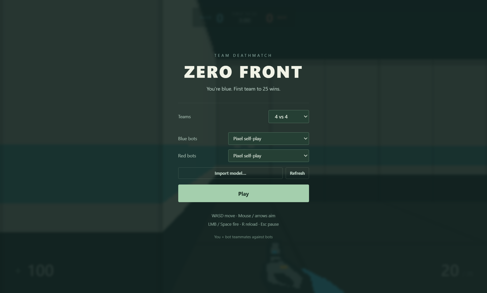

# Zero Front

Zero Front is a first-person team deathmatch environment for humans and learning agents. Play **4 vs 4** by default, first team to **25 eliminations** or the highest score after **3 minutes**. Team size supports 1–8 actors per side, with automatic respawns. One human plays locally alongside bots; network multiplayer is not implemented.

The repository includes **Pixel self-play** weights. The standalone game selects this model for both teams' bots on first launch, so you can play with trained agents immediately. **Scripted** remains available in each team's dropdown. No Python, PyTorch, or model training is needed to play.



New matches alternate between five procedural structures: room networks, rings, warehouses, linked courtyards, and offset corridors. Each structure varies by seed, with reflection or rotational symmetry for equivalent starting areas. Agents can repeat a layout by resetting with the same seed.

## Play

Install Git and Node.js **22.12+**, then run:

```sh
git clone https://github.com/SnyderConsulting/zero-front.git
cd zero-front/prototype
npm install
npm start
```

This opens the standalone Electron game. After installing dependencies, Windows users can also double-click **Play Zero Front.cmd** in the repository root.

WASD moves, mouse or arrow keys aim, left mouse button or Space fires, R reloads, and Escape pauses and releases the mouse. F11 toggles fullscreen. Switching apps pauses the game and releases the mouse. End-of-round results include a top-down replay with panning, zooming, and player facing directions.

Use `npm run web` in the prototype directory for the optional browser / HTTP server. See the [agent API guide](./prototype/AGENT_API.md) for agent control.

## Agents and training

The bundled agent observes **64×36 first-person semantic RGB pixels** and six values describing its own status. It learned from scripted demonstrations and teacher corrections, then continued learning through self-play. Its deployed controller receives no map, world coordinates, or hidden enemy positions. Playing strength is experimental; the model does not consistently beat Scripted.

The weights in [models/pixel-selfplay.json](./prototype/models/pixel-selfplay.json) are a snapshot at the repository commit. The game does not download model updates automatically. Use `git pull` to get later published snapshots, then open **New match** or press **Refresh** in round setup. A running round keeps the weights it started with.

Training requires Python, PyTorch, and NumPy. The [training guide](./prototype/training/README.md) covers imitation, self-play, rewards, and ten-minute benchmarks. Local datasets, optimizer checkpoints, logs, and run reports are excluded from Git. See the [game guide](./prototype/README.md) for controls, replays, and model imports, and the [model notes](./prototype/models/README.md) for the bundled policy's contract.
